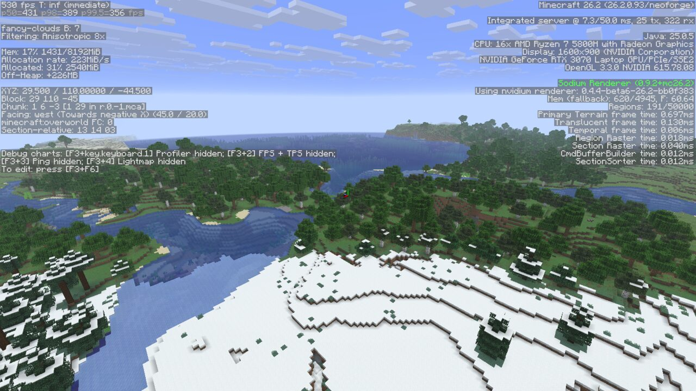
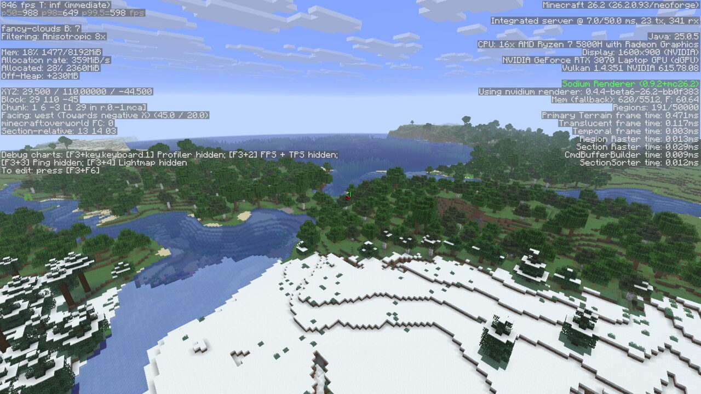

# Nvidium-vk

[](https://www.patreon.com/cw/svfr)
[](LICENSE.txt)

## Requirements

- An **NVIDIA GPU, Turing (GTX 16xx / RTX 20xx) or newer**, with a current driver. Both backends need
  mesh shaders; the OpenGL backend additionally needs `GL_NV_*` extensions that only NVIDIA ships. Other
  vendors are out of scope.
- Minecraft **26.2** with **NeoForge 26.2.0.93** (the Vulkan backend hooks private parts of Mojang's
  Vulkan code and is pinned to this version).
- **Sodium 0.9.2+mc26.2** (NeoForge build).
- On Vulkan: Mojang's Vulkan backend selected in *Video Settings* (`preferredGraphicsBackend`). The
  `neoloadingvulkanfix` mod is recommended with NeoForge's early loading screen.

## What it is

Nvidium, the GPU-driven terrain renderer for Sodium on NVIDIA cards, ported to **NeoForge 26.2** and
taught to run on **Minecraft's Vulkan backend**.

A fork of [MCRcortex/nvidium](https://github.com/MCRcortex/nvidium) (branch `26.2`) that

- runs on **NeoForge 26.2** instead of Fabric, and
- renders on **Minecraft's Vulkan backend** as well as on OpenGL.

Nvidium is an alternative terrain renderer for Sodium. It keeps the whole world's geometry on the GPU, culls
it there (mesh shaders, GPU occlusion culling, one indirect draw for the terrain) and renders large render
distances at frame rates vanilla Sodium cannot reach. Upstream is OpenGL-only and uses NVIDIA extensions;
since Minecraft 26.x can run on Vulkan, where those extensions do not exist, this fork adds a second backend
built on `VK_EXT_mesh_shader` and buffer device addresses on top of Mojang's own Vulkan renderer.

## Installation

Drop the jar from the [releases page](https://github.com/__GITHUB_OWNER__/Nvidium-vk/releases) into
`mods/` next to Sodium. Nothing else to configure: when the game starts, nvidium checks the GPU and the
active graphics backend and logs either `Enabling Nvidium` or the missing requirement. In F3, the right
column shows `Using nvidium renderer: <version>` and the GPU time of each nvidium pass. Nvidium's own
options (memory limit, fog, translucency sorting, statistics) are on the *Nvidium* page of Sodium's video
settings.

## Performance

RTX 3070 Laptop, driver 615.78.08, 1600×900, vsync off, same world and camera for every row, 30 s per
run (`bench/`). Vanilla Sodium on each backend is the baseline.

| render distance | OpenGL Sodium | OpenGL Nvidium | Vulkan Sodium | Vulkan Nvidium |
|---:|---:|---:|---:|---:|
| 16 | 806 FPS | 850 FPS | 1444 FPS | 1380 FPS |
| 24 | 673 FPS | 733 FPS | 997 FPS | 1086 FPS |
| 32 | 588 FPS | 653 FPS | 752 FPS | **926 FPS** |

With Distant Horizons (LOD radius 128, render distance 32): Vulkan Sodium 286 FPS, Vulkan Nvidium 303 FPS.
At render distance 16 the frame is under a millisecond and nvidium's fixed per-frame work does not pay
off; the mod is for large render distances. Full tables, 1 % lows and percentiles:
[docs/VULKAN_PLAN.md §8](docs/VULKAN_PLAN.md), raw data in `docs/bench-results.jsonl`.

| OpenGL | Vulkan |
|---|---|
|  |  |

## How the Vulkan backend works

Everything GPU-related goes through `me.cortex.nvidium.backend.IRenderBackend`, with one implementation per
graphics API (`backend/gl`, `backend/vk`). The Vulkan one records into Mojang's single command buffer
between Mojang's render passes: it owns a VMA allocator with buffer device addresses (Mojang's buffers
cannot carry them), opens its own dynamic-rendering instances for the mesh-shader draws, runs the culling
compute passes in between, and keeps the upstream frame structure (draw with last frame's visibility,
occlusion raster, command build, temporal draw) unchanged. The GLSL shaders exist in two dialects:
upstream's `GL_NV_mesh_shader` sources and a `GL_EXT_mesh_shader` / `GL_EXT_buffer_reference2`
translation under `assets/nvidium/shaders/vk/`, compiled at runtime with shaderc.

The design, the milestones and what was measured along the way are in
[docs/VULKAN_PLAN.md](docs/VULKAN_PLAN.md); how Mojang's Vulkan backend runs a frame, with source
references, is in [docs/VULKAN_FRAME_PROTOCOL.md](docs/VULKAN_FRAME_PROTOCOL.md).

## Building

```sh
./gradlew build          # jar in build/libs/
./gradlew runClient      # dev client; add -PvkValidation=true for the Khronos validation layers
```

Java 25 is required (the Gradle toolchain plugin downloads one). The quality gate used for every change
is `mise run check` (formatting, Error Prone, lint rules, an offline compile of every Vulkan shader with
`glslc`, secret scan); see [AGENTS.md](AGENTS.md) for the rules and the benchmark harness under `bench/`.

## Known limitations

- NVIDIA only, by design.
- Pinned to NeoForge 26.2.0.93 / Sodium 0.9.2 (mixins into Mojang's Vulkan backend and Sodium internals).
- Tested on one machine (Linux, Wayland, RTX 3070). Windows is expected to work on both backends but was
  not run here.
- Changing the statistics level needs a renderer reload (same as upstream).

## License and credits

[LGPL-3.0](LICENSE.txt), the same license as the original repository. Nvidium is by
[Cortex](https://github.com/MCRcortex). The NeoForge port and the Vulkan backend in this fork are by
Vladimir Filatov ([svfr](https://www.patreon.com/cw/svfr)) and Claude (Anthropic) as co-authors. Sodium is
by the CaffeineMC team.
